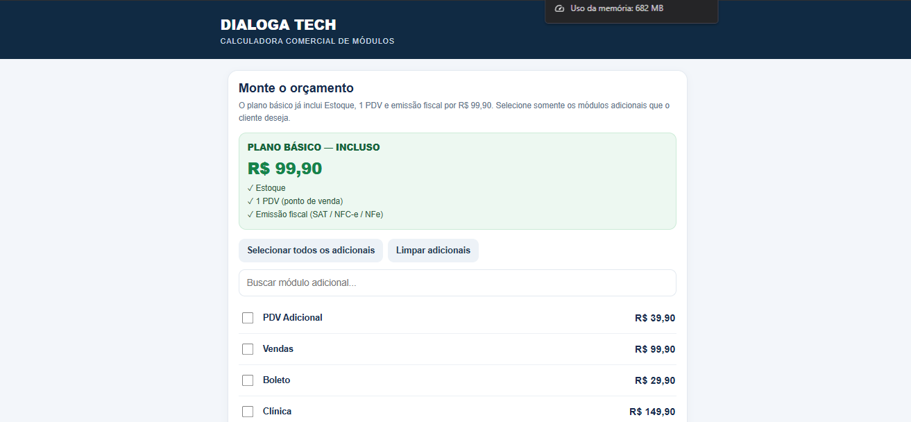

# 🧮 Calculadora de Módulos

Ferramenta desenvolvida para facilitar a composição de planos e propostas comerciais de sistemas de gestão empresarial (ERP), permitindo selecionar módulos e calcular os valores conforme a necessidade de cada cliente.

## 📌 Sobre o projeto

A Calculadora de Módulos ERP foi desenvolvida para auxiliar o processo comercial da Dialoga Tech na apresentação e comercialização de sistemas de gestão.

A ferramenta permite selecionar os módulos disponíveis no sistema, montar combinações personalizadas e calcular os valores correspondentes à solução escolhida.

O objetivo é simplificar a elaboração de propostas comerciais, agilizar o atendimento e facilitar a apresentação de soluções adequadas às necessidades de cada empresa.

## 🚀 Funcionalidades

Seleção dos módulos disponíveis no sistema ERP.

Composição de planos personalizados.

Cálculo automatizado dos valores conforme os módulos selecionados.

Agilidade na elaboração de propostas comerciais.

Interface simples e intuitiva.

Facilidade na apresentação de soluções aos clientes.

## 🖥️ Demonstração

## 🛠️ Tecnologias utilizadas

*html, css e javascript.*

## 📂 Como utilizar

1. Acesse o repositório.
2. Baixe ou clone o projeto.
3. Abra os arquivos conforme as instruções de instalação.
4. Utilize a calculadora.

## 👨‍💻 Desenvolvedor

**Dialoga Tech**

Desenvolvimento de soluções tecnológicas para facilitar processos e melhorar a produtividade.

Empresa focada na comercialização, implantação e suporte de soluções tecnológicas para empresas, contribuindo para a melhoria da gestão e produtividade dos negócios.

---

Desenvolvido por Dialoga Tech.